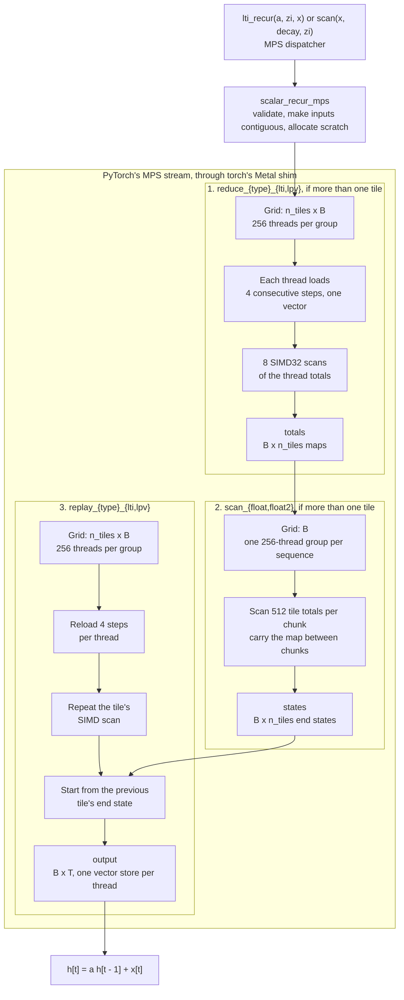

# Metal recurrence implementations

This directory contains philtorch's native CPU, CUDA, and Metal sources.
The Metal implementations of the linear recurrence come in two: the scalar one, M = 1, described first, and that of M states, up to 128 (64 complex), in [the last section](#metal-recurrence-of-m-states).
The scalar recurrence, time-invariant and time-varying, lives in [`scalar_recur_mps.mm`](scalar_recur_mps.mm) (host code) and [`scalar_recur_mps.metal`](scalar_recur_mps.metal) (kernels).
It implements

```text
h[b, t] = a * (t == 0 ? zi[b] : h[b, t - 1]) + x[b, t]
```

with `a` one coefficient per step (`philtorch::scan`, time-varying) or per sequence, shared or not (`philtorch::lti_recur`, time-invariant), as an associative affine scan.
It takes float32, float16, bfloat16 and complex64, accumulating float16 and bfloat16 in float32.
One three-pass design serves every input: reduce each tile, scan the tile totals of each sequence, and replay each tile from the state before it.

## Source map

| File | Role |
| --- | --- |
| [`ops.cpp`](ops.cpp) | Creates the `philtorch._C` module and defines the dispatcher schemas of the recurrence ops, `philtorch::lti_recur` among them. |
| [`host_recur.cpp`](host_recur.cpp) | CPU kernels of the recurrence ops, `philtorch::scan` included, split over time when a batch has fewer sequences than threads, long enough for the split to pay. |
| [`stable_support.h`](stable_support.h) | What every source needs beyond torch's stable C++ API, which they use alone (`torch/csrc/stable`, `torch/headeronly`): the target version, `build_support.MIN_TORCH`, `opmath_type`, `ceil_div`, dtype predicates, `current_cuda_stream`, and, for CUDA sources, the `USE_CUDA` definition. |
| [`host_dot.h`](host_dot.h) | The dot product of the CPU kernels of the recurrence ops and of `lpc`, vectorized for float and double from size 8. |
| [`torchlpc_shim.cpp`](torchlpc_shim.cpp) | Defines the schemas of `philtorch::scan` and `philtorch::lpc`, and the CPU kernel of `lpc`, one sequence per thread. |
| [`mps_shim.h`](mps_shim.h) | What the Metal host sources share of torch's Metal C shim: compiling a shader after `mps_common.metal`, looking up and launching kernels, and the Metal type and accumulation type of each dtype. |
| [`mps_common.metal`](mps_common.metal) | What the Metal kernels share, compiled at the head of each shader: the SIMD width, the accumulation types and complex products. |
| [`scalar_recur_mps.mm`](scalar_recur_mps.mm) | MPS host code of `lti_recur` and `scan`, on torch's stable ABI and Metal C shim. |
| [`scalar_recur_mps.metal`](scalar_recur_mps.metal) | Their Metal kernels, embedded in the extension at build time. |
| [`recur_mps.mm`](recur_mps.mm) | MPS host code of `lti_recurN` and `recurN`, M up to 128 (64 complex), which `lti_recur2`, `recur2`, `lti_recur3` and `recur3` run too. |
| [`recur_mps.metal`](recur_mps.metal) | Their Metal kernels, compiled once per state size and dtype. |
| [`../_ops.py`](../_ops.py) | Registers fake implementations and autograd for the recurrence ops. |
| [`../_recur.py`](../_recur.py) | Sends recurrences on MPS to `lti_recur` or `scan` for M = 1, and to `lti_recurN` or `recurN` for M up to 128 (64 complex). |
| [`../../tests/test_recur.py`](../../tests/test_recur.py) | `test_recurrence_low_precision` checks MPS against a float64 reference in every dtype and coefficient layout, for M = 1 and above; other MPS tests cover the chunk boundaries, deep recursion over the chunks, a large batch, gradients and dispatch. |
| [`../../tests/test_recur_ext.py`](../../tests/test_recur_ext.py) | MPS tests of the carry across chunks of tiles, of gradients and of the inputs the kernels reject. |
| [`../../benchmarks/benchmark_mps_recur.py`](../../benchmarks/benchmark_mps_recur.py) | Reproduces the CPU/MPS runtime results. |

## Turning a recurrence into a scan

A `Pair { m, v }` represents the affine map

```text
f(h) = m * h + v.
```

`compose(left, right)` applies two adjacent maps in sequence:

```text
compose(left, right)
    = (left.m * right.m, left.v * right.m + right.v)
    = right(left(h)).
```

Composition is associative, so the maps can be evaluated with a parallel prefix scan.
It is not commutative; changing the operand order changes the recurrence.
For complex64, `m` and `v` are complex numbers (`float2`), multiplied as such.

Step `t` of sequence `b` is the map

```text
p[0] = (0, a * zi[b] + x[b, 0])
p[t] = (a, x[b, t])            for t > 0
identity = (1, 0)              past the end
```

The first map folds the initial state in, and its zero multiplier makes every map composed from the start of a sequence a constant: its `m` is zero and its `v` is the state.
So the inclusive prefix at step `t` holds `h[b, t]` in `v`, and a tile needs only the state at the end of the tile before it, while the first tile needs none.
Steps past the end are identities, so partial tiles need no padding pass.

## Execution



Let

```text
TILE    = 256 threads * 4 steps = 1024 steps
n_tiles = ceil(T / TILE)
```

The kernels are encoded in order on PyTorch's current MPS stream, which orders them without a CPU round trip.
A sequence of one tile runs the replay alone: one dispatch, which reads its input once.

### Stage 1: reduce tiles

`reduce` runs one 256-thread threadgroup for every `(tile, sequence)` pair.
Thread `lid` loads steps `4 * lid` to `4 * lid + 3` of its tile with one vector load (`packed_float4` and the like, which need only the element's alignment), so a SIMD group reads 128 consecutive steps.
Time-varying coefficients are loaded the same way; a time-invariant one is read once per thread.

1. Each thread composes its four maps into one total.
2. `simd_inclusive` scans those totals with `simd_shuffle_up` at offsets 1, 2, 4, 8, and 16.
3. Lane 31 of each SIMD group writes its total to threadgroup memory, and SIMD group 0 scans the eight totals.
4. The last thread writes the tile's map to `totals`.

### Stage 2: scan tile totals

`scan`, one kernel per accumulation type (float for float32, float16 and bfloat16, and float2 for complex64), runs one 256-thread threadgroup per sequence, which scans its tile totals two per thread, 512 at a time, carrying the map so far between chunks of 512.
It writes `v`, the state, of each inclusive prefix to `states`: the state at the end of each tile.

### Stage 3: replay tiles

`replay` runs the same grid as stage 1, reloads the steps, and repeats the tile's scan, which gives each thread the map from the tile's start to its first step.
Applied to the end state of the previous tile (zero for the first tile, whose first map is constant), it gives the thread's starting state, from which the thread runs its four steps in sequence and writes them with one vector store.
Replaying the scan costs SIMD arithmetic, but rereads the input instead of writing and rereading per-step prefixes.

## Buffers and launch geometry

| Buffer | Shape | Purpose |
| --- | --- | --- |
| `decays` | `(1,)`, `(B,)` or `(B, T)` | Shared, per-sequence or per-step coefficient. |
| `zi` | `(B,)` | Initial state. |
| `x` | `(B, T)` | Input sequence. |
| `totals` | `(B, n_tiles)` maps | One map per tile, two values of the accumulation type. |
| `states` | `(B, n_tiles)` | The state at the end of each tile. |
| `output` | `(B, T)` | Recurrence result. |

Scratch, in float32 (two floats per value for complex64), is `3 * B * n_tiles` values, and none for sequences of one tile.
The dominant traffic is reading `x` (and per-step coefficients) twice and writing `output` once.

| Property | Value |
| --- | --- |
| Tile size | 1024 steps |
| Threads per tile | 256 |
| Steps per thread | 4, one vector load and store |
| SIMD width | 32 lanes |
| SIMD groups per tile | 8 |
| Metal dispatches | 3, or 1 for sequences of one tile |

The tile, threadgroup, SIMD and vector constants are coupled: `THREADS`, `K` and `TOTALS` in the Metal source, `THREADS` and `STEPS_PER_THREAD` in the host code.
Every kernel declares 256 threads as its maximum per threadgroup (`max_total_threads_per_threadgroup`), so the compiler guarantees that size; every Apple GPU has 32-wide SIMD groups, which the kernels assume, as the shim gives no way to query the width.
Each kernel indexes the steps of a sequence in 32 bits, as 64-bit integer arithmetic is emulated on the GPU: per-sequence pointers are computed once per thread, and the host rejects sequences of 2^32 - 1024 steps or more.

## PyTorch and Metal integration

The host code uses only torch's stable ABI, `torch/csrc/stable` and `torch/headeronly`, and torch's Metal C shim, [`shim_mps.h`](https://github.com/pytorch/pytorch/blob/main/torch/csrc/inductor/aoti_torch/c/shim_mps.h), so the compiled code calls torch through C functions alone.
Like the other sources, it includes `stable_support.h`, which holds it to `MIN_TORCH`'s API.
No Objective-C remains, and the extension links no Apple framework.

1. `setup.py` turns each `.metal` file into a header in `build/metal`, a raw string named after the file (`scalar_recur_mps.metal` is `SCALAR_RECUR_MPS_METAL`), which the host code includes.
2. On first use, `aoti_torch_mps_create_shader_library` compiles that source after `mps_common.metal`, and `aoti_torch_mps_get_kernel_function` looks up the kernels, which stay cached for the process.
3. Scratch tensors are ordinary MPS tensors from the stable `new_empty`, so PyTorch manages their memory.
4. Inputs are made contiguous; `aoti_torch_mps_set_arg_tensor` binds a tensor's buffer at its storage offset.
5. `aoti_torch_mps_run_command_block` encodes each dispatch on PyTorch's MPS stream.
   Its callback records the first error code, which the host raises after the block returns, so that no C++ exception crosses the shim's C frames.

PyTorch's stable-ABI notes promise its C shim, `shim.h`, and the generated `c_shim_*.h` for at least two years, but don't name `shim_mps.h`, which AOTInductor's MPS models depend on.

## Dispatcher and autograd

`ops.cpp` and `torchlpc_shim.cpp` define the schemas.
The MPS registration at the end of `scalar_recur_mps.mm` maps

```text
philtorch::lti_recur -> lti_recur_mps
philtorch::scan      -> scan_mps
```

Both schemas have a custom autograd formula in `philtorch/_ops.py`.
Their backward passes express the reverse recurrence with the same dispatcher operations, so the MPS forward and backward both run these kernels.

## Edge cases

- `lti_recur` rejects a zero-length sequence, because its autograd formula needs a final output state; `scan` returns an empty result. An empty batch returns without a Metal dispatch.
- As in the CUDA scans, maps compose with plain products: where an unstable recurrence's composed multiplier overflows, the states become NaN or infinite, even a zero state, which the sequential recurrence keeps at zero.
- The parallel order of operations rounds differently from a sequential loop, so the tests compare with per-dtype tolerances.

## CPU and MPS benchmark

Measured on an Apple M1 Pro (14-core GPU) with macOS 26.7.1, PyTorch 2.13.0 and six CPU threads, by

```bash
pixi run python benchmarks/benchmark_mps_recur.py
```

which reports the median latency of `torch.utils.benchmark.Timer.blocked_autorange` over at least 500 ms, interquartile range in parentheses, synchronizing PyTorch's MPS stream at each measurement boundary; input transfers are excluded.
The CPU kernel of `scan` takes no float16 or bfloat16 (`n/a`).
Every dtype and layout is on [issue #39](https://github.com/yoyolicoris/philtorch/issues/39/artifacts/2).

| dtype | B | T | Coefficients | CPU median ms (IQR) | MPS median ms (IQR) | Speedup |
| :--- | ---: | ---: | :--- | ---: | ---: | ---: |
| float32 | 1 | 262144 | shared | 0.2628 (0.0120) | 0.0365 (0.0018) | 7.21x |
| float32 | 64 | 65536 | batched | 1.2449 (0.1513) | 0.2629 (0.0287) | 4.74x |
| float32 | 256 | 4096 | batched | 0.5239 (0.0486) | 0.0949 (0.0052) | 5.52x |
| float32 | 1 | 262144 | per_step | 0.2613 (0.0176) | 0.0392 (0.0020) | 6.67x |
| float32 | 64 | 65536 | per_step | 1.3154 (0.1581) | 0.5133 (0.0260) | 2.56x |
| float16 | 64 | 65536 | per_step | n/a | 0.2222 (0.0114) | n/a |
| bfloat16 | 64 | 65536 | per_step | n/a | 0.2446 (0.0096) | n/a |
| complex64 | 64 | 65536 | per_step | 5.9108 (0.5093) | 1.0301 (0.0318) | 5.74x |

## Build and verification

`setup.py` checks that torch is `build_support.MIN_TORCH` or newer. On macOS, it adds every `.mm` source to the C++ extension and generates its headers in `build/metal`.
The extension needs no OpenMP runtime, as the CPU kernels run on torch's threads, so Apple Clang builds it.

Rebuild the editable extension after changing the host code or the Metal source:

```bash
pixi reinstall philtorch
```

Run the MPS tests with:

```bash
pixi run pytest tests/test_recur.py tests/test_recur_ext.py -k "mps or low_precision" -q
```

They run 301 and 2049 steps, one tile and three, each ending mid-vector, and `T = 1024 * 512 + 5`, so that stage 2 carries a map across more than one chunk of 512 tile totals.

## Metal recurrence of M states

[`recur_mps.mm`](recur_mps.mm) and [`recur_mps.metal`](recur_mps.metal) implement `lti_recurN` and `recurN` on MPS,

```text
h[b, t] = A[b, t] h[b, t - 1] + x[b, t],   h[b, -1] = zi[b],
```

for M up to 128 (64 for complex64), the Triton kernels' limit, in the same four dtypes as the scalar kernels, accumulating in float32 (complex64 for complex64).
`_recur.py` sends M = 1 to the scalar kernels, which are faster, and M from 2 on here.

### Algorithm

The design follows the Triton kernels of [`../_recur_kernels.py`](../_recur_kernels.py), without their decoupled look-back, which needs a forward-progress guarantee Apple GPUs don't give.
Every sequence longer than one chunk of 64 steps is split into chunks, whatever the batch: one behaviour for every input.
The state at a chunk's end is the affine map `h -> P h + o` of the state at its start, with `P` the product of the chunk's matrices and `o` its end state from a zero start.
Chunk 0 starts from `zi` instead, as step 0 does in the CUDA `recur2` and `recur3`, so the scan of the maps starts from zero: chunk 0's `P` is then irrelevant, zero for time-varying `A`, and `A^64`, shared, for time-invariant `A`.

1. `recur_reduce` computes the map of every chunk but the last: `o` per chunk of each sequence, and `P` per chunk of each distinct time-varying `A`, 8 columns at a time, as the product of the chunk's matrices by those columns of the identity. Time-invariant `A` has one `P`, `A^64`, the same for every chunk, computed the same way from one chunk's steps.
2. The state at each chunk's end is the same recurrence over the chunks, with `P` as its matrices and `o` as its inputs, from a zero start: the host runs it recursively, in the accumulation type, until a level fits in one chunk. A sequence of `T` steps takes about `log_64(T)` levels.
3. `recur_run` runs every chunk from the state at the previous chunk's end, writing the states.

Time-invariant `A` costs two passes over the steps; time-varying `A` costs `M` more for the maps, once per distinct `A`, so `M + 2` when each sequence has its own.

### Execution

The library is compiled from source on the first call for each state size and dtype, with `STATES`, `SCALAR` and `THREADS` (per threadgroup) defined before `mps_common.metal`, so that every loop over the states unrolls and the states stay in registers.
Every loop over states, lanes and tiles is unrolled whole (`clang loop unroll(full)`): left to the compiler, the larger ones kept a loop, whose arrays then lived in memory, up to 30 times as slow.

**Vectors.** A vector of `M` states, a chunk's state, runs on `LANES` lanes of a SIMD group, `M` rounded up to a power of 2 and 32 at most, so that a SIMD group holds `32 / LANES` vectors; above 32 states, each lane holds `ceil(M / 32)` of them, `j`, `j + 32`, and so on.
Lane `j` holds state `j` and reads column `j` of each step's matrix, so that a vector's lanes read the row-major matrix in order.
A step forms each lane's share of every row, the products of its columns by its states, and a butterfly of `log2(LANES)` rounds of `simd_shuffle_xor` sums the shares over the lanes, a block of `LANES` rows at a time: each round, a lane keeps the half of the rows its lane's bit selects and adds its partner's other half, until it holds its own row's sum.
The first round is taken as the shares are formed, so that a lane holds half a block's at most: with all of them, complex64 at `M = 32` spilled its registers and ran six times as long.
Every shuffle exchanges lanes by a mask shared by all lanes, which Apple GPUs run faster than shuffles from a lane index of each lane's own.

**Maps.** A map's `P` runs 8 columns at a time on a SIMD group: the `M x 8` block `X <- A[t] X`, in tiles of 8 x 8, by `simdgroup_multiply_accumulate`, the Metal counterpart of Triton's `tl.dot`, in float32, complex64 as four real products.
The tiles of `A[t]` are read entry by entry into `thread_elements()`, converted to the accumulation type, in the layout that every Apple GPU shares and MLX's matrix products rely on.
A block's columns evolve apart from the others', so it needs only its own `2 ceil(M / 8)` floats a lane, in registers whatever `M`, where the Triton kernels' maps from 32 states on alternate between two scratch buffers.
Against a vector per column, each with its own butterfly, the maps of `M = 32` over 16 sequences of 4096 steps ran in 4.5 ms rather than about 14, and float32 at `M = 128` reached about half the GPU's peak.

Vectors run consecutive chunks of a sequence, 32 at most, in runs as even as a sequence's chunks allow, those of each sequence in turn, then the next run: the vectors in flight then read neighbouring inputs, and the matrices of time-varying `A` shared over the batch at once.
Against this order, `recur_run` of `M = 16` over 64 sequences of 65536 steps took 2.7 times as long with neighbouring vectors on the same chunk of different sequences, its vectors' inputs spread over hundreds of megabytes, and 2.4 times as long for time-varying `A` shared over the batch with every chunk of one sequence before the next sequence's, which read `A` again for each sequence.

| Buffer | Shape | Purpose |
| --- | --- | --- |
| `A` | `(M, M)`, `(B, M, M)`, `(T, M, M)` or `(B, T, M, M)` | Shared or per-sequence, time-invariant or per-step matrices. |
| `offsets` | `(B, C - 1, M)` | Each chunk's `o`, `C` chunks per sequence. |
| `maps` | `(Ba, C - 1, M, M)`, or `(Ba, 1, M, M)` for time-invariant `A` | Each chunk's `P`, `Ba` the distinct `A`s. |
| `starts` | `(B, C - 1, M)` | The state at each chunk's end, from the recursion. |

The kernels index the steps of a sequence and the grid's lanes in 32 bits, and the inputs' offsets in 64; the host rejects inputs whose chunks need more lanes.
As in the scalar kernels, maps compose with plain products: an unstable recurrence whose chunk maps overflow gives NaN or infinite states, even where the sequential recurrence stays finite.

### Benchmark

Measured on an Apple M1 Pro (14-core GPU) as the scalar kernels' benchmark, by

```bash
pixi run python benchmarks/benchmark_mps_recur.py --states 2 4 8 16 32 64 128
```

The tables are on the pull request that added these kernels; against the CPU, outside one sequence of 4096 steps:

- time-invariant `A`, and time-varying `A` shared over the batch, run 0.9 to 11.5 times as fast in float32 and complex64, and from 0.5 times in float16 and bfloat16, slowest at `M = 32`;
- time-varying `A` of each sequence's own, whose maps cost `M` more passes, runs 1.2 to 8.6 times as fast at `M` up to 4 or 65536 steps and more, but is slower from `M = 8` in batches of 4096 steps, down to 0.1 times at `M = 32` in bfloat16.

One sequence of 4096 steps, whose dispatches cost more than its steps, runs 0.2 to 2.4 times as fast.
